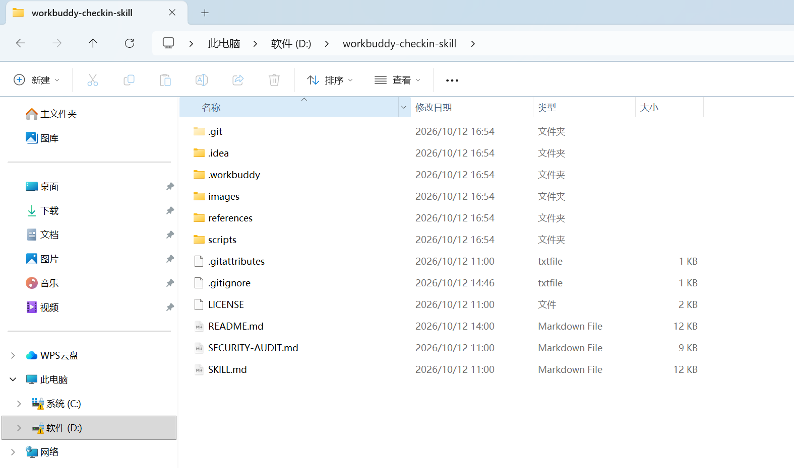
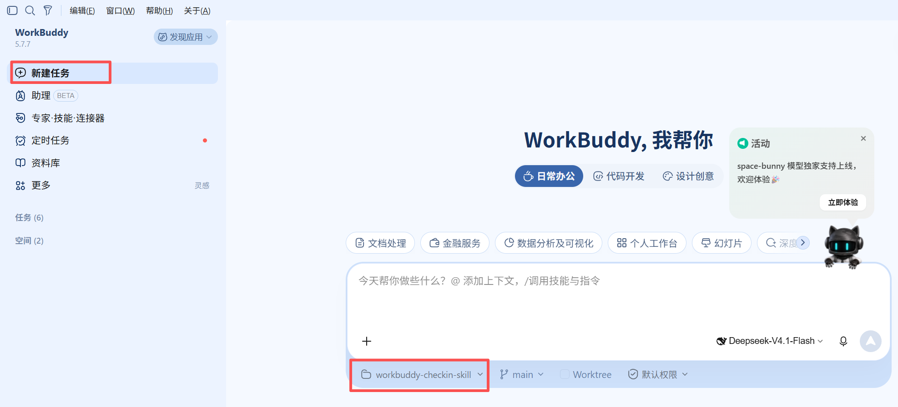
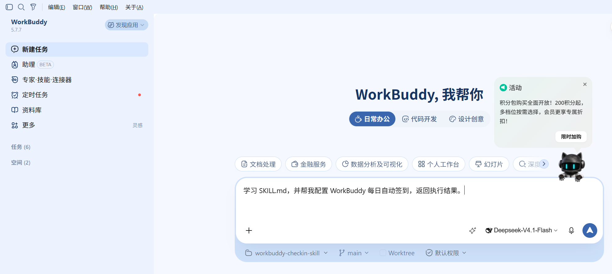
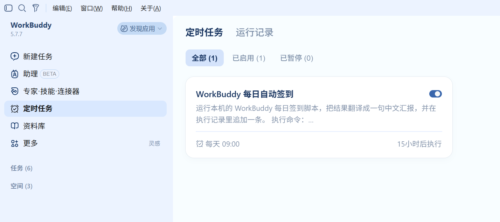
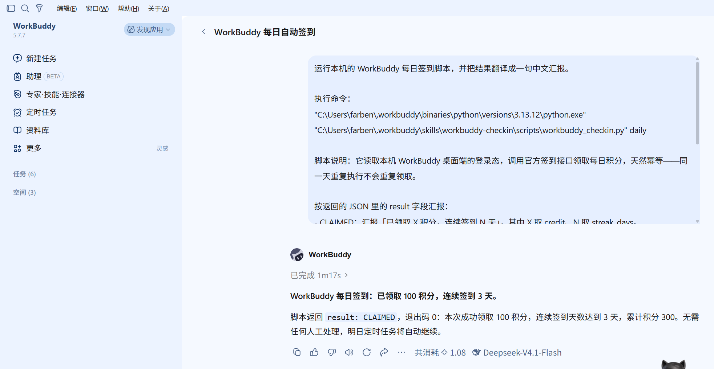

# workbuddy-checkin-skill

> WorkBuddy 每日积分自动签到 Skill —— 全本机运行，无后端，令牌不落盘。

每天自动领取 WorkBuddy「Buddy 加油站」的 100 积分（连续第 7 天 1000 积分），再也不怕忘记签到断连。

## 它做了什么

1. 读取本机 WorkBuddy 桌面端的登录态（明文 JSON 与 `sym-v1` 加密信封都能处理）
2. 查签到状态 → 未签到则调用官方接口领取
3. 幂等：今日已签到自动跳过，一天跑十次也不会重复领取
4. 支持注册系统定时任务，实现无人值守

## 最简方式：WorkBuddy 内置 Skill 目录（推荐小白）

不需要敲命令。把本仓库当成本地 skill 目录，让 WorkBuddy 自己每天执行。

### 1. 把本仓库放到 skill 目录

在电脑上新建一个文件夹（例如 D:\workbuddy-checkin-skill），把本仓库的 SKILL.md 复制进去。



### 2. 在 WorkBuddy 里新建任务

打开 WorkBuddy 桌面端 → 左侧「新建任务」→ 工作目录选择 `workbuddy-checkin-skill` 这个文件夹。



### 3. 粘贴提示词并启动

在对话里粘贴以下内容（可以直接复制）：

```
学习 SKILL.md，并帮我配置 WorkBuddy 每日自动签到，返回执行结果。
```



WorkBuddy 会读取目录里的 `SKILL.md`、跑一次 `scripts/workbuddy_checkin.py` 验证链路，
并按需创建定时任务。

### 4. 在「自动化」里查看定时任务

创建成功后，进入左侧「自动化」→ 即可看到「WorkBuddy 每日自动签到」定时任务。



### 5. 等它执行，看结果

任务运行后，WorkBuddy 会返回类似结果：



```
已领取 100 积分，连续签到 3 天
```

> 如果当天已经手动领取过，它会返回「今日已签到，无需重复领取」，不会重复加分。

## 快速开始（命令行方式）

想先手动验证一次，或者更喜欢脚本：

### 前提

- 已安装并**登录** WorkBuddy 桌面端（[官网下载](https://www.codebuddy.cn/work/)）
- 系统已安装 Python 3.8+（Windows 可用自带 `python`，或从 [python.org](https://www.python.org) 安装）


### Windows（PowerShell）

```powershell
# 1. 克隆仓库
git clone https://github.com/zhuoyanzhe/workbuddy-checkin-skill.git
cd workbuddy-checkin-skill

# 2. 离线自检：凭据格式 + 解密能力（不联网）
python scripts\workbuddy_checkin.py doctor

# 3. 立即签到
python scripts\workbuddy_checkin.py daily
```

### macOS / Linux

```bash
git clone https://github.com/zhuoyanzhe/workbuddy-checkin-skill.git
cd workbuddy-checkin-skill

# 2. 环境检查（不联网）
python3 scripts/workbuddy_checkin.py doctor

# 3. 立即签到
python3 scripts/workbuddy_checkin.py daily
```

预期输出：

- `{"result": "CLAIMED", ...}` → 当日领取成功
- `{"result": "ALREADY", ...}` → 已领过，幂等结束
- `{"result": "AUTH_REJECTED", ...}` → 令牌过期，打开 WorkBuddy 刷新登录态

## 设置定时任务（零 Token）

系统级定时器直接跑本地脚本，**完全不经过 AI 模型，不消耗会话额度**。

电脑非全天开机时，建议配置多个时间点补签（脚本幂等，重复运行无副作用）。

### Windows（任务计划程序）

```powershell
powershell -ExecutionPolicy Bypass -File .\scripts\install-task.ps1
# 卸载：加上 -Uninstall
```

会注册两个任务：`WorkBuddyAutoSignin`（每天 00:05）与 `WorkBuddyAutoSigninPoll`
（01/05/09/13/17/21 各一次，已签则静默）。

用多个独立触发器而不是「每天一次 + 每 N 小时重复」，是因为重复实例一旦错过（关机 / 睡眠）
就永久跳过，独立触发器则每次错过都还有机会补跑。

### macOS / Linux（crontab）

```bash
crontab -e
# 添加（替换实际路径）
5 0,9,13,18,21 * * * /usr/bin/python3 /path/to/scripts/workbuddy_checkin.py silent >> /path/to/signin.log 2>&1
```

### macOS launchd（长期后台）

创建 `~/Library/LaunchAgents/com.user.workbuddy-checkin-skill.plist`，`StartCalendarInterval`
用数组配置多时间点，详见 [SKILL.md](SKILL.md)。

## 安全说明

| 项目 | 说明 |
|------|------|
| 令牌存储 | 仅内存使用，管道即时消费，**不落盘、不回显、不写日志**（输出中的令牌会被替换为 `[REDACTED]`） |
| 解密密钥 | 只在解密子进程内，用完立即清零；父进程拿不到，也不写临时文件 |
| 网络访问 | 仅发往凭据声明的官方 endpoint（默认 `copilot.tencent.com`），**不访问任何第三方** |
| 日志内容 | 仅积分 / 连续天数 / 成功失败，**绝不含令牌** |
| 系统修改 | 只读登录态文件，**不修改 WorkBuddy 本体** |
| 第三方依赖 | 零依赖，无供应链投毒面 |
| 安全审计 | 0 个 P0/P1 风险项，结论见 [`SECURITY-AUDIT.md`](SECURITY-AUDIT.md) |

> **凭据即账号密码**：解密出的 `accessToken` 等同你的 WorkBuddy 账号密码。切勿将脚本输出、
> 日志粘贴分享或提交到仓库。

## 文件结构

```
workbuddy-checkin-skill/
├── SKILL.md                      # Skill 规范文档（WorkBuddy 读它来触发与执行）
├── README.md                     # 本文件：面向人的安装与用法
├── SECURITY-AUDIT.md             # 安全审计报告
├── LICENSE                       # MIT
├── images/                       # README 配图（见 images/README.md 的拍摄清单）
├── scripts/
│   ├── workbuddy_checkin.py      # 核心脚本（零第三方依赖）
│   └── install-task.ps1          # Windows 计划任务一键安装 / 卸载
└── references/
    ├── credential-bridge.md      # 凭据格式与 sym-v1 解密桥原理
    └── troubleshooting.md        # 排错速查
```

## 排错速查

完整版见 [`references/troubleshooting.md`](references/troubleshooting.md)。

| 现象 | 原因 | 处理 |
|------|------|------|
| `NO_AUTH` | 凭据文件不存在 | 打开 WorkBuddy 桌面端登录一次；`looked_in` 字段会列出全部探测路径 |
| `RUNTIME_NOT_FOUND` | 找不到客户端 | 用 `WORKBUDDY_EXE` 指定 `WorkBuddy.exe` 完整路径 |
| `RUNTIME_UNAVAILABLE` | 客户端版本过旧，没有存储原生绑定 | 升级 WorkBuddy 桌面端 |
| `KEY_MISMATCH` | 凭据与所选客户端的密钥不匹配（多版本共存） | 用 `WORKBUDDY_EXE` 指向写出该凭据的那个客户端 |
| `AUTH_REJECTED`（HTTP 401） | 令牌过期 | 打开客户端刷新登录态，次日自动恢复 |
| 计划任务失败但日志是空的 | `silent-poll` 下非 ERROR 结果**不写日志** | 查计划任务的 `LastTaskResult`，别只看日志 |
| PowerShell 中文乱码 / 解析报错 | ps1 缺 UTF-8 BOM，被 GBK 误读 | 本仓库的 `install-task.ps1` 已含 BOM，勿去掉 |

## 原理（进阶）

### 凭据

桌面端登录后把会话写到 `%LOCALAPPDATA%\CodeBuddyExtension\Data\Public\auth\workbuddy-desktop.info`
（macOS 为 `~/Library/Application Support/...`）。

> 目录叫 `CodeBuddyExtension` 是客户端代码里写死的常量（`EXTENSION_DATA_DIR_NAME`），
> **与是否安装 CodeBuddy 无关** —— 文件名 `workbuddy-desktop.info` 才是产品身份。
> 脚本按候选清单依次探测（`CodeBuddyExtension` / `WorkBuddyExtension` / `WorkBuddy`
> 三种前缀 × Windows + macOS 路径，再加 `~/.workbuddy/auth/` 兜底，共 7 个），
> 命中了哪一个看 `doctor` 输出的 `auth_file` 字段。也可用 `WORKBUDDY_AUTH_FILE` 显式指定。

`auth.accessToken` 有两种形态：

| 形态 | 表现 | 处理 |
|---|---|---|
| 明文 | 字符串 | 直接使用，纯 Python 即可 |
| 加密 | `{"$wbEncrypted":1,"envelope":"..."}` | 交给客户端自带的 Electron 运行时在隐藏子进程内解密 |

加密形态是 `sym-v1 / suite 1`：密钥**不在磁盘上**，由客户端原生绑定
`process._linkedBinding('electron_browser_workbuddy_storage').loggerGet()` 在进程内提供，
键为 `sha256(atRestSecretKey)`，算法是 AES-256-GCM（带定长 AAD 结构）。
密钥全程留在子进程内，明文令牌只经 stdout 管道回传。

细节见 [`references/credential-bridge.md`](references/credential-bridge.md)。

### 接口

```
查状态:  POST {endpoint}/v2/billing/meter/checkin-activity-status
领积分:  POST {endpoint}/v2/billing/meter/daily-checkin
```

- `endpoint` 取凭据里的 `auth.endpoint`，缺省 `https://copilot.tencent.com`。
- 请求头对齐桌面端：`Authorization: Bearer <token>`、`X-User-Id: <uid>`，有域信息时加 `X-Domain`。
- 幂等靠 **HTTP 400 + `code:10001`**（今天已签到）兜底，不依赖 `today_checked_in` 字段 ——
  实测该字段在签到成功后仍可能为 `false`。
- **不要用响应体子串判 401**：响应体带随机 UUID 的 `requestId`，偶含 `401` 会被误判为令牌过期，
  导致当天不签到、连签中断。一律用真实 HTTP 状态码。

## 实测验证

2026-10-08 ~ 10-12 在本机（Windows + WorkBuddy 桌面端 5.7.x / Electron 37.10.3）实测：

| 验证项 | 命令 | 结果 |
|---|---|---|
| 加密凭据识别与运行时探测 | `doctor` | `AUTH_READY`，`credential_format=sym-v1` |
| 解密 + 服务端认证 | `status` | **HTTP 200** |
| 写接口构造与幂等分支 | `claim` | **HTTP 400 + `code:10001`**「今天已签到，请明天再来」→ 按 `ALREADY` 处理 |
| 凭据路径候选兜底 | 4 组模拟场景 | 三种前缀与兜底路径均按序命中，空目录正确返回未找到 |
| 无人值守链路 | `install-task.ps1` 注册的任务实跑 | `LastTaskResult=0`，`signin.log` 正常落盘 |
| **每日自动领取** | 内置自动化连续实跑 | 10-09 ~ 10-12 **连续 4 天 4 次 `CLAIMED`**：连签 3 → 4 → 5 → 6 天，累计积分 300 → 400 → 500 → 600 |

`claim` 能返回 `code:10001` 而不是 401，说明服务端对**写请求的鉴权已通过**，请求构造正确性得到证明。


## License

MIT，见 [LICENSE](LICENSE)。

## 免责声明

本项目为**非官方**工具，与腾讯及 WorkBuddy 无任何隶属关系。签到接口系从桌面端 `app.asar`
逆向所得，服务端改版即可能失效。

本工具的等价操作是「每天手动点一次领取今日礼包」，仅操作**本机当前登录用户自己的**账户。
请勿用于他人账户、批量注册刷分或任何违反 WorkBuddy 用户协议的用途。使用者自行承担风险。
